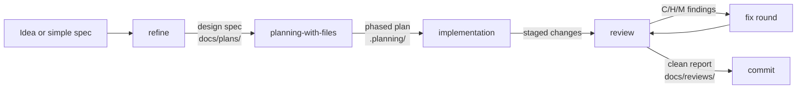

# Design: README workflow diagram

## Context

Add a Mermaid diagram to the "Workflow" section of `README.md` (added in commit 4d3f22d) to illustrate the refine → planning-with-files → review loop.

Decisions locked during brainstorming:

- D1: Mermaid in the README, inside the Workflow section (GitHub renders Mermaid natively)
- D2: the loop with the fix cycle — three main boxes, artifacts on edges, C/H/M fix back-edge, clean-report → commit exit

## 1. The diagram (proposed text)

A `flowchart LR` with the three skill boxes, artifacts on the edges, the fix back-edge, and the commit exit:

- Three main boxes (`refine`, `planning-with-files`, `review`) with `implementation` as the work between plan and review
- Artifacts on the edges: `docs/plans/` → `planning-with-files` → `.planning/` → review → `docs/reviews/` → commit
- The fix cycle is a visible back-edge (`C/H/M findings → fix round → review`), and the exit is the `clean report → commit` edge
- Placement: in the Workflow section, between the numbered list and the supporting line — the text first, the diagram as the visual summary
